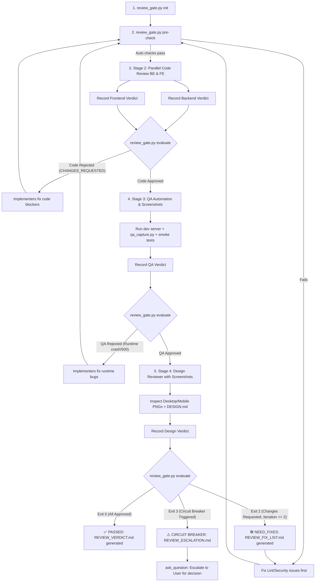

# /review — Staged 4-Phase Quality Gate

> Enforces a strictly sequenced, fail-fast Quality Gate:
> **1. Auto Pre-Checks ➔ 2. Code Review (FE/BE) ➔ 3. QA Testing & Screenshots ➔ 4. Design & Visual Sign-off.**

---

## 🎯 Purpose

Activate the **Quality Gate** after implementation is complete, or whenever `/review` is invoked.
Ensures no code is merged or declared finished without independent, stage-gated validation:

1. **Machine Pre-Checks:** Static analysis, linting, type-checking, and secret scanning ($0, fast fail).
2. **Code Reviewers (Parallel):**
   - **Backend Reviewer** (API, Database, Security, Error Handling, Clean Code)
   - **Frontend Reviewer** (Component Architecture, State, Reactivity, Clean Props)
3. **QA Automation Reviewer:**
   - Dev/Preview server smoke testing, runtime error check, and **visual capture** (Desktop 1440px + Mobile 375px screenshots).
4. **Design Reviewer:**
   - **Visual inspection of real screenshots** + adherence to `DESIGN.md`, typography, spacing scale, anti-slop aesthetics.

---

## 🔴 Strict Workflow Protocol



---

### Step 1: Initialize Gate
Run the gatekeeper to prepare or reset the state:
```bash
python3 .agents/scripts/review_gate.py init
```

---

### Step 2: Automated Pre-Checks (Stage 1)
Run static linters and security checks before involving LLM reviewers:
```bash
python3 .agents/scripts/review_gate.py pre-check
```
> If pre-checks fail, fix the reported errors immediately before proceeding.

---

### Step 3: Code Review (Stage 2 — Parallel)
Launch Backend and Frontend reviewers in parallel using `invoke_subagent`:

#### Subagent 1: Backend Reviewer
- **Role:** `Backend Reviewer`
- **Type:** `research`
- **Focus Areas:**
  - API endpoints, request/response contracts, HTTP status codes
  - Database schema, queries, indexing, N+1 issues
  - Input validation, SQL/NoSQL injection, OWASP Top 10
  - Error handling, transaction boundaries, idempotent operations
- **Prompt Template:**
  ```markdown
  Review recent changes in the repository from a Senior Backend Engineer perspective.
  Inspect git diff and modified backend files.
  Evaluate: API consistency, database interactions, security, error handling, clean code.
  Return your review in the following exact format:
  VERDICT: APPROVED or CHANGES_REQUESTED
  SUMMARY: [One sentence summary]
  BLOCKERS:
  - [Blocker 1 (if CHANGES_REQUESTED)]
  SUGGESTIONS:
  - [Nit 1 (non-blocking)]
  ```

#### Subagent 2: Frontend Reviewer
- **Role:** `Frontend Reviewer`
- **Type:** `research`
- **Focus Areas:**
  - Component hierarchy, single responsibility, clean prop interfaces
  - State management tiers (local vs server vs global), unnecessary re-renders
  - Bundle hygiene and maintainable patterns
- **Prompt Template:**
  ```markdown
  Review recent changes in the repository from a Senior Frontend Engineer perspective.
  Inspect git diff and modified frontend/client files.
  Evaluate: Component architecture, state management, reactivity, clean props, code quality.
  Return your review in the following exact format:
  VERDICT: APPROVED or CHANGES_REQUESTED
  SUMMARY: [One sentence summary]
  BLOCKERS:
  - [Blocker 1 (if CHANGES_REQUESTED)]
  SUGGESTIONS:
  - [Nit 1 (non-blocking)]
  ```

**Record Code Verdicts:**
```bash
python3 .agents/scripts/review_gate.py record --reviewer backend --verdict <APPROVED|CHANGES_REQUESTED> --summary "..." [--blocker "..."] [--suggestion "..."]
python3 .agents/scripts/review_gate.py record --reviewer frontend --verdict <APPROVED|CHANGES_REQUESTED> --summary "..." [--blocker "..."] [--suggestion "..."]
python3 .agents/scripts/review_gate.py evaluate
```
> 🛑 **Fail-Fast Rule:** If either reviewer returns `CHANGES_REQUESTED`, `evaluate` will immediately halt with exit code 2 and generate `REVIEW_FIX_LIST.md`. Do NOT proceed to QA or Design until code issues are resolved!

---

### Step 4: QA Testing & Visual Capture (Stage 3)
Once Stage 2 is approved, run the QA Automation Engineer:

- **Role:** `QA Automation Engineer`
- **Type:** `research` (or self)
- **Actions:**
  1. Start the preview server if needed:
     ```bash
     python3 .agents/scripts/auto_preview.py start
     ```
  2. Capture Desktop & Mobile screenshots:
     ```bash
     python3 .agents/scripts/qa_capture.py --url http://localhost:3000
     ```
  3. Verify console logs, HTTP responses, and basic smoke tests.
- **Record QA Verdict:**
  ```bash
  python3 .agents/scripts/review_gate.py record --reviewer qa --verdict <APPROVED|CHANGES_REQUESTED> --summary "..." [--blocker "..."]
  python3 .agents/scripts/review_gate.py evaluate
  ```
> 🛑 **Fail-Fast Rule:** If the server crashes or smoke tests fail, halt and fix runtime blockers before Design review.

---

### Step 5: Design & Visual UX Sign-off (Stage 4)
Once Stage 3 is approved, invoke the Design Reviewer:

- **Role:** `Design Reviewer`
- **Type:** `research`
- **Inputs:**
  - View real screenshots captured by QA via `view_file`:
    - `.agents/artifacts/screenshots/desktop_1440x900.png`
    - `.agents/artifacts/screenshots/mobile_375x812.png`
  - Inspect `DESIGN.md` design tokens and guidelines.
- **Focus Areas:**
  - Visual hierarchy, contrast ratios, and layout alignment on real screen sizes.
  - Mobile responsiveness (no horizontal scroll, tap targets readable).
  - Anti-slop aesthetics: Ensure UI looks crafted and deliberate, not generic AI template.
- **Record Design Verdict:**
  ```bash
  python3 .agents/scripts/review_gate.py record --reviewer design --verdict <APPROVED|CHANGES_REQUESTED> --summary "..." [--blocker "..."]
  ```

---

### Step 6: Final Gate Evaluation
Execute the final gatekeeper evaluation:
```bash
python3 .agents/scripts/review_gate.py evaluate
```

#### Outcome Handling:
1. **Exit Code 0 (All Approved):**
   - The task has passed Quality Gate!
   - `REVIEW_VERDICT.md` contains the full multi-perspective signed-off report.
   - Stop preview server (`python3 .agents/scripts/auto_preview.py stop`).
   - Proceed to task delivery or PR creation.

2. **Exit Code 2 (Need Fixes — Iteration < 2):**
   - Review failed at one of the stages. `REVIEW_FIX_LIST.md` has been generated with all blockers.
   - Implementers fix the items in `REVIEW_FIX_LIST.md`.
   - Once fixes are made, repeat from Step 2 (Pre-checks) -> Re-review.

3. **Exit Code 3 (Circuit Breaker Triggered — 2 Iterations Reached):**
   - The automated review loop is HALTED immediately to prevent infinite churning.
   - `REVIEW_ESCALATION.md` has been created with all unresolved blockers.
   - **MANDATORY:** The orchestrator MUST call `ask_question` with options:
     - *(Recommended)* Override & Accept trade-offs
     - Authorize a 3rd manual attempt with specific user instructions
     - Revert offending changes
