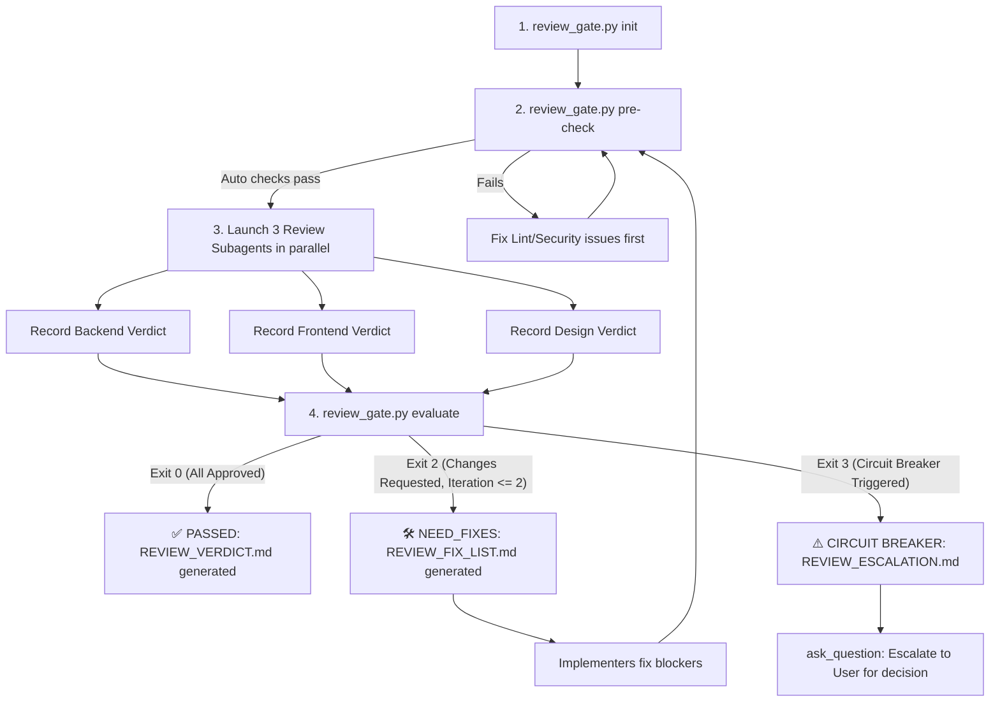

# /review — Multi-Perspective Quality Gate

> Enforces comprehensive Backend, Frontend, and Design reviews with a deterministic 2-iteration feedback loop and circuit breaker.

---

## 🎯 Purpose

Activate the **Quality Gate** after implementation is complete, or whenever `/review` is invoked.
Ensures no code is merged or declared finished without independent validation from 3 perspectives:
1. **Backend Reviewer** (API, Database, Security, Error Handling, Clean Code)
2. **Frontend Reviewer** (Component Architecture, State, Reactivity, a11y, Performance)
3. **Design Reviewer** (Design Tokens, Typography, Spacing, Anti-slop, Mobile & Responsive UX)

---

## 🔴 Strict Workflow Protocol



---

### Step 1: Initialize Gate
Run the gatekeeper to prepare or reset the state:
```bash
python3 .agents/scripts/review_gate.py init
```

---

### Step 2: Automated Pre-Checks
Run static linters and security checks before involving LLM reviewers:
```bash
python3 .agents/scripts/review_gate.py pre-check
```
> If pre-checks fail, fix the reported errors immediately before proceeding.

---

### Step 3: Launch 3 Parallel Review Subagents
Invoke all 3 reviewers using `invoke_subagent` in a single tool call:

#### Subagent 1: Backend Reviewer
- **Role:** `Backend Reviewer`
- **Type:** `research`
- **Focus Areas:**
  - API endpoints, request/response contracts, HTTP status codes
  - Database schema, queries, indexing, N+1 issues
  - Input validation, SQL/NoSQL injection, OWASP Top 10
  - Error handling, transaction boundaries, idempotent operations
- **Prompt Template:**
  ```markdown
  Review recent changes in the repository from a Senior Backend Engineer perspective.
  Inspect git diff and modified backend files.
  Evaluate: API consistency, database interactions, security, error handling, clean code.
  Return your review in the following exact format:
  VERDICT: APPROVED or CHANGES_REQUESTED
  SUMMARY: [One sentence summary]
  BLOCKERS:
  - [Blocker 1 (if CHANGES_REQUESTED)]
  SUGGESTIONS:
  - [Nit 1 (non-blocking)]
  ```

#### Subagent 2: Frontend Reviewer
- **Role:** `Frontend Reviewer`
- **Type:** `research`
- **Focus Areas:**
  - Component hierarchy, single responsibility, clean prop interfaces
  - State management tiers (local vs server vs global), unnecessary re-renders
  - Accessibility (ARIA labels, keyboard navigation, semantic HTML)
  - Loading, error, and empty states
  - Core Web Vitals impact and bundle hygiene
- **Prompt Template:**
  ```markdown
  Review recent changes in the repository from a Senior Frontend Engineer perspective.
  Inspect git diff and modified frontend/client files.
  Evaluate: Component architecture, state management, reactivity, accessibility, performance.
  Return your review in the following exact format:
  VERDICT: APPROVED or CHANGES_REQUESTED
  SUMMARY: [One sentence summary]
  BLOCKERS:
  - [Blocker 1 (if CHANGES_REQUESTED)]
  SUGGESTIONS:
  - [Nit 1 (non-blocking)]
  ```

#### Subagent 3: Design & UI Reviewer
- **Role:** `Design Reviewer`
- **Type:** `research`
- **Focus Areas:**
  - Strict adherence to design tokens (color palette, spacing scale, typography)
  - Anti-slop check: Ensure UI does not look like generic, unstyled AI templates
  - Visual hierarchy, contrast ratios (WCAG compliance), hover/active states
  - Mobile, tablet, and desktop responsive adaptation
- **Prompt Template:**
  ```markdown
  Review recent changes in the repository from a Design System Lead & UX Specialist perspective.
  Inspect modified UI components, layouts, styles, and templates.
  Evaluate: Design token fidelity, visual hierarchy, anti-slop aesthetics, responsive behavior, contrast.
  Return your review in the following exact format:
  VERDICT: APPROVED or CHANGES_REQUESTED
  SUMMARY: [One sentence summary]
  BLOCKERS:
  - [Blocker 1 (if CHANGES_REQUESTED)]
  SUGGESTIONS:
  - [Nit 1 (non-blocking)]
  ```

---

### Step 4: Record Verdicts
Record the verdict of each subagent into the gatekeeper:
```bash
python3 .agents/scripts/review_gate.py record --reviewer backend --verdict <APPROVED|CHANGES_REQUESTED> --summary "..." [--blocker "..."] [--suggestion "..."]
python3 .agents/scripts/review_gate.py record --reviewer frontend --verdict <APPROVED|CHANGES_REQUESTED> --summary "..." [--blocker "..."] [--suggestion "..."]
python3 .agents/scripts/review_gate.py record --reviewer design --verdict <APPROVED|CHANGES_REQUESTED> --summary "..." [--blocker "..."] [--suggestion "..."]
```

---

### Step 5: Evaluate State & Enforce Loop
Execute gatekeeper evaluation:
```bash
python3 .agents/scripts/review_gate.py evaluate
```

#### Outcome Handling:
1. **Exit Code 0 (All Approved):**
   - The task has officially passed Quality Gate!
   - `REVIEW_VERDICT.md` contains the signed-off report.
   - Proceed to task delivery or PR creation.

2. **Exit Code 2 (Need Fixes — Iteration < 2):**
   - Review failed. `REVIEW_FIX_LIST.md` has been generated with all blockers.
   - Implementers MUST fix the items in `REVIEW_FIX_LIST.md`.
   - Once fixes are made, repeat from Step 2 (Pre-checks) -> Step 3 (Re-review).

3. **Exit Code 3 (Circuit Breaker Triggered — 2 Iterations Reached):**
   - The automated review loop is HALTED immediately to prevent infinite churning.
   - `REVIEW_ESCALATION.md` has been created with all unresolved blockers.
   - **MANDATORY:** The orchestrator MUST call `ask_question` with options:
     - *(Recommended)* Override & Accept trade-offs
     - Authorize a 3rd manual attempt with specific user instructions
     - Revert offending changes
